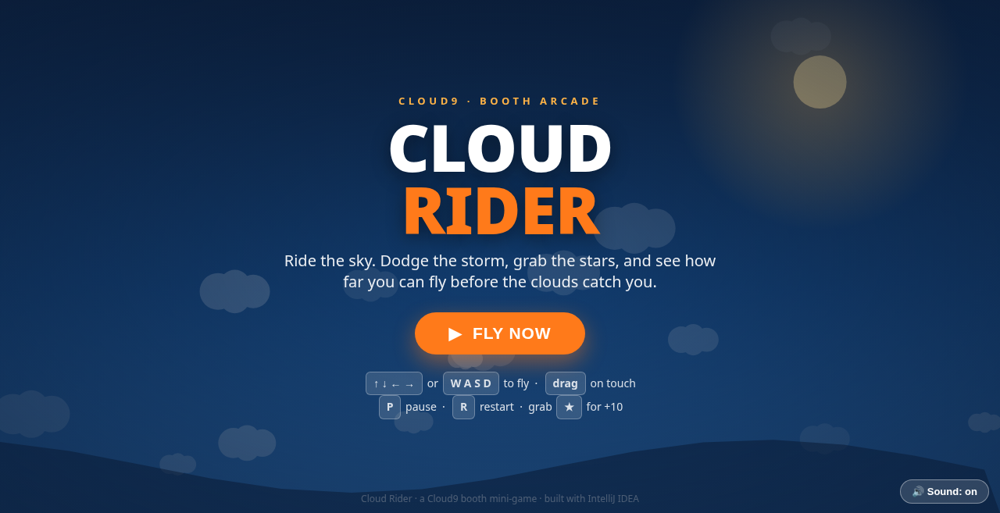

# Cloud Rider — a Cloud9 booth mini-game

An arcade flying game built for the **Cloud9 x JetBrains "Sky's The Limit" Hackathon 2026**,
Category 3 (Event Mini Game). Ride the sky, dodge the storm, grab the stars, and see how
far you can fly before the clouds catch you.

**Play it live:** https://buahrasa01-hub.github.io/cloud9-booth-game/



## How to play

| Control | Action |
|---|---|
| `↑ ↓ ← →` or `W A S D` | Fly |
| Drag (touch / mouse) | Steer |
| `P` / `Esc` | Pause |
| `R` | Restart |
| `M` | Mute / unmute sound |
| `Enter` | Start |

- **★ Stars** — collect for +10 points each.
- **⛈ Storm clouds, birds, lightning bolts** — dodge them. A hit costs one of 3 lives.
- **🛡 Shield pickup** — blocks one hit for 6 seconds.
- Speed and spawn rate rise the longer you fly. Your best score is saved locally.

## Run it locally

No build step, no dependencies — just open `index.html` in a browser, or serve it:

```bash
python3 -m http.server 8000
# open http://localhost:8000
```

## Tech

- Single-file HTML5 + Canvas game (`index.html`, ~19 KB of JavaScript), zero dependencies.
- All art is drawn with canvas vector shapes — no third-party assets.
- Tiny WebAudio synth for sound effects (no audio files).
- Responsive: keyboard + touch, any screen size.

## Built with JetBrains

This project was built and edited in **IntelliJ IDEA Community Edition** (free, 2025.3),
a JetBrains IDE. See [AI_SHOWCASE.md](AI_SHOWCASE.md) for the full story of how the
JetBrains tooling was used — and the [methodology](#methodology) below.

## Methodology

**Problem.** A conference booth needs a game that a passer-by understands in 5 seconds,
can finish (or lose) in under a minute, and makes them stay for "one more try". It must
run on any booth machine with no install, no account, and no network dependency beyond
the page itself.

**Approach.**
1. **One mechanic, mastered in seconds:** fly with arrows/WASD or drag. No tutorial
   needed — the menu shows the controls in two lines.
2. **Readability at a glance:** a night-sky gradient, a bright orange player, yellow
   stars, dark storm clouds with a lightning warning. The threat and the reward are
   visible from across the room.
3. **A 60-second arc:** speed and spawn rate ramp with time, so every run ends —
   usually in 30–90 seconds — and the "NEW BEST" chase brings people back.
4. **Forgiving, then fair:** 3 lives, a short invincibility window after a hit, and a
   shield pickup keep new players alive long enough to learn, while the ramp keeps
   veterans honest.
5. **Zero-friction deployment:** one HTML file, no build, no assets, no server logic.
   It runs from a static host, a USB stick, or a laptop with no Wi-Fi.

**What was tested.** Automated playtests in headless Chrome (CDP): menu → play (score
increases, lives intact) → no-input run ends in Game Over with the final score shown and
the best score saved → restart returns to play with lives restored. Screenshots of each
state are in [`screenshots/`](screenshots/).

## License

MIT — see [LICENSE](LICENSE).
